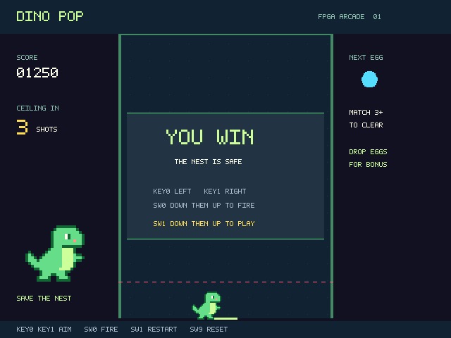
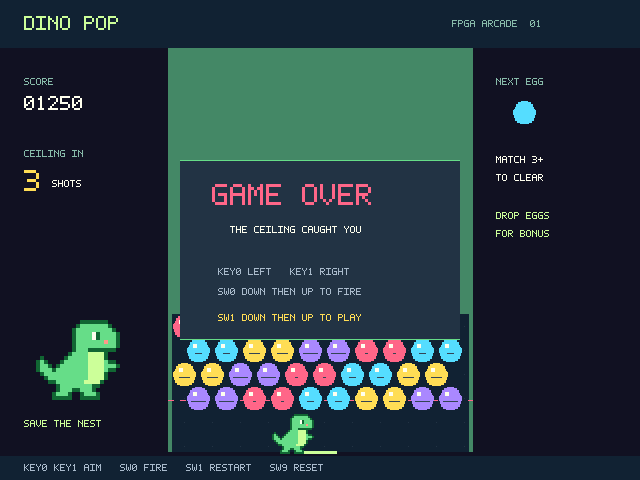
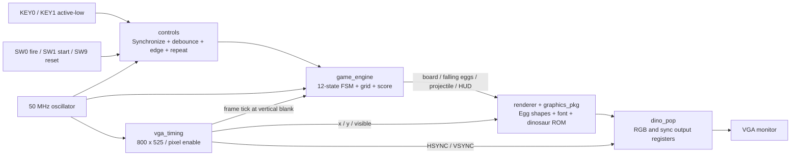
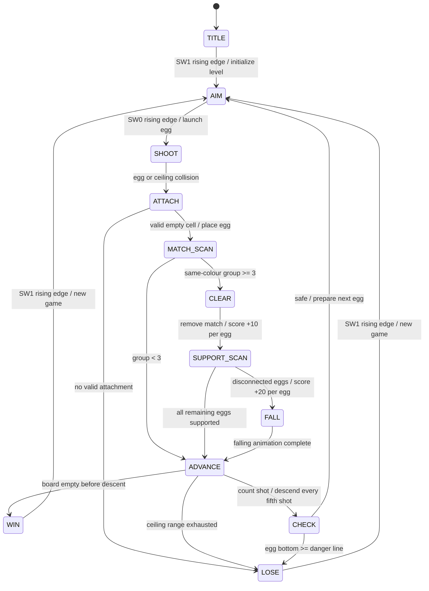

# Dino Pop — DE10-Lite / VHDL

เกมยิงไข่สีแนว Dynomite สำหรับ **DE10-Lite, MAX 10 10M50DAF484C7G** เขียนด้วย **VHDL-2008** ใช้ Quartus Prime Lite และ VGA **640×480 ที่ประมาณ 59.52 Hz** ควบคุมด้วยปุ่มและสวิตช์บนบอร์ด โดยมี **FSM 12 สถานะ** เป็นตัวควบคุมเกม

ยิงไข่ให้เชื่อมกับไข่สีเดียวกันอย่างน้อย 3 ใบเพื่อทำลายกลุ่ม ไข่ที่ไม่เชื่อมกับเพดานจะตกลงมา เพดานเลื่อนลงทุก 5 นัด เคลียร์ไข่ทั้งหมดก่อนถึงเส้นอันตรายเพื่อชนะ


> ภาพในเอกสารสร้างจาก VHDL renderer ใน simulation ไม่ใช่ภาพถ่ายจากบอร์ดจริง ชุดทดสอบทั้ง 4 ชุดและ GHDL synthesis ผ่านแล้ว แต่ **Quartus fitting, timing closure และการทดสอบบนบอร์ดยังไม่ผ่านการยืนยัน** เนื่องจาก Windows บล็อก `ip-catalog.exe` ของ Quartus จึงยังไม่มีไฟล์ `.sof` ดูรายละเอียดที่ [ผลตรวจสอบ](docs/verification.md)

## เปิดและลงบอร์ด

1. เปิด [quartus/dino_pop.qpf](quartus/dino_pop.qpf) ใน Quartus Prime Lite ที่ติดตั้ง **MAX 10 device support** แล้ว
2. เลือก **Processing → Start Compilation** หรือรัน `./scripts/build.ps1` ใน PowerShell จากโฟลเดอร์หลักของโปรเจกต์
3. เมื่อ compile สำเร็จ ให้ตรวจรายงาน fitting และ timing ใน `quartus/output_files/` ก่อนลงบอร์ด
4. ต่อ USB-Blaster และจอ VGA เข้ากับ DE10-Lite
5. เปิด **Tools → Programmer** เลือก USB-Blaster และโหมด **JTAG**
6. เพิ่ม `quartus/output_files/dino_pop.sof` เลือก **Program/Configure** แล้วกด **Start**
7. ตั้งสวิตช์ทั้งหมดลง โดยเฉพาะ `SW9=0` แล้วโยก `SW1` ขึ้นเพื่อเริ่มเกม

ขั้นตอนลงบอร์ดต้องทำหลังแก้ปัญหา Quartus และได้ไฟล์ `.sof` จริงแล้ว ไฟล์ `.sof` ใช้ทดลองผ่าน JTAG และไม่คงอยู่หลังปิดไฟ โปรเจกต์นี้ไม่เขียน configuration flash อัตโนมัติ

## วิธีเล่น

- **KEY0:** เล็งซ้าย กดค้างเพื่อเลื่อนมุมต่อเนื่อง
- **KEY1:** เล็งขวา กดค้างเพื่อเลื่อนมุมต่อเนื่อง
- **SW0:** โยกจากลงเป็นขึ้นเพื่อยิงหนึ่งนัด ต้องโยกลงก่อนยิงนัดต่อไป
- **SW1:** โยกจากลงเป็นขึ้นเพื่อเริ่มเกมหรือเริ่มใหม่ ใช้ได้แม้กำลังยิงหรือมีไข่ตก
- **SW9=1:** รีเซ็ตและหยุดเกมไว้ ตั้งกลับเป็น 0 เพื่อกลับหน้าพร้อมเริ่ม

อินพุตผ่าน synchronizer สองขั้นและ debounce ประมาณ **10 ms** ปุ่มเล็งกดค้างแล้วทำซ้ำทุก **150 ms** กด KEY0 และ KEY1 พร้อมกันจะไม่เปลี่ยนมุม ระหว่างยิง ตรวจกลุ่ม หรือแสดงไข่ตก จะไม่รับการเล็งและการยิงเพิ่ม เหตุการณ์ยิงระหว่างนั้นถูกทิ้งและไม่ถูกเก็บไว้ยิงภายหลัง

### กติกาและคะแนน

- ตารางไข่ขนาด **10 คอลัมน์ × 12 แถว** เรียงเยื้องกัน เริ่มด้วยไข่ 4 แถว
- ไข่มี 4 สี: ชมพู ฟ้า เหลือง และม่วง พร้อมลายช่วยแยกสี
- เล็งได้ **17 มุม** ตั้งแต่ −64° ถึง +64° ทีละ 8° ไข่สะท้อนผนังซ้ายและขวาได้
- กลุ่มสีเดียวกันที่เชื่อมต่อกันตั้งแต่ **3 ใบ** จะหายไป ได้ **10 คะแนนต่อใบ**
- ไข่ที่หลุดการเชื่อมต่อกับเพดานจะตก ได้ **20 คะแนนต่อใบ**
- คะแนนสูงสุด **99,999** มีช่องแสดงไข่ถัดไป และเลือกสีจากสีที่ยังเหลือในตาราง
- ทุก **5 นัดที่ประมวลผลเสร็จ** เพดานเลื่อนลง 24 พิกเซล
- **ชนะ:** ไม่มีไข่เหลือ ตรวจเงื่อนไขนี้ก่อนเลื่อนเพดาน
- **แพ้:** ขอบล่างของไข่แตะหรือผ่านเส้น `y=400` หรือไม่มีช่องว่างที่ใช้ติดไข่ได้

<details>
<summary>ดูหน้าพร้อมเล่น หน้าชนะ และหน้าแพ้จาก simulation</summary>

### หน้าพร้อมเล่น


### หน้าชนะ



### หน้าแพ้



</details>

## Block diagram



ทุกโมดูลใช้ clock **50 MHz เดียว** วงจร VGA ใช้ enable ทุกสองรอบ clock จึงได้อัตราพิกเซล 25 MHz โดยไม่สร้าง clock จาก logic การเคลื่อนที่ของไข่อัปเดตหนึ่งครั้งต่อเฟรม ส่วนการค้นหาการชนและกลุ่มไข่ทำงานทีละขั้นที่ 50 MHz หลังเริ่ม vertical blank

## State diagram



**เงื่อนไขร่วมทุกสถานะ:** `SW9` มีลำดับสูงสุดและนำกลับ `TITLE` พร้อมล้างข้อมูลเกม ส่วนขอบขาขึ้นของ `SW1` เริ่มรอบใหม่ที่ `AIM` ได้จากทุกสถานะ กราฟแสดงเฉพาะเส้นทางหลักเพื่อให้อ่านง่าย สถานะคงเดิมจนกว่าเงื่อนไขเปลี่ยนสถานะจะครบ และปุ่มเล็ง/ยิงมีผลเฉพาะ `AIM`

### หน้าที่ของแต่ละสถานะ

1. **TITLE:** แสดงชื่อเกมและวิธีควบคุม รอเริ่มเกม
2. **AIM:** รับการเล็ง แสดงไข่ปัจจุบันและเส้นประ รอคำสั่งยิง
3. **SHOOT:** ขยับไข่ตาม frame tick สะท้อนผนัง และตรวจการชน
4. **ATTACH:** เลือกช่องว่างที่เหมาะสมใกล้จุดชน ถ้าไม่มีช่องให้จบเกม
5. **MATCH_SCAN:** ใช้ BFS ตรวจเพื่อนบ้าน 6 ทิศของไข่สีเดียวกัน
6. **CLEAR:** ลบกลุ่มที่มีอย่างน้อย 3 ใบและเพิ่มคะแนน
7. **SUPPORT_SCAN:** เริ่ม BFS จากแถวบนสุด หาไข่ที่ยังเชื่อมกับเพดาน
8. **FALL:** แสดงไข่ที่หลุดจากเพดานตกลงมา โดยนำออกจากตารางการชนแล้ว
9. **ADVANCE:** ตรวจว่าชนะหรือไม่ แล้วนับนัดและเลื่อนเพดานเมื่อครบ 5 นัด
10. **CHECK:** ตรวจเส้นอันตรายและเตรียมสีไข่ถัดไป ก่อนกลับไปเล็ง
11. **WIN:** แสดงผลชนะและคะแนน รอเริ่มใหม่หรือรีเซ็ต
12. **LOSE:** แสดงผลแพ้และคะแนน รอเริ่มใหม่หรือรีเซ็ต

ดู [State table ฉบับเต็ม](docs/state_table.csv) สำหรับเงื่อนไข การทำงาน และสถานะถัดไป รวมถึง global reset/restart และดู [รายงานการออกแบบ](docs/report.md) สำหรับรายละเอียดอัลกอริทึม

## ข้อมูลและ VGA

`game_engine` ส่งตารางไข่ ตารางไข่ที่กำลังตก สถานะ มุมยิง ตำแหน่งไข่ คะแนน ระดับเพดาน จำนวนยิง และสีไข่ปัจจุบัน/ถัดไปให้ `renderer` โดยชนิดข้อมูลหลักอยู่ใน [game_pkg.vhd](rtl/game_pkg.vhd)

- **Grid:** 120 ช่อง แต่ละช่องเป็นว่างหรือสี 1–4 แถวคี่เยื้องขวา 14 พิกเซล
- **Projectile:** ตำแหน่ง fixed-point ละเอียด 1/256 พิกเซล ใช้ตารางความเร็วแทนการคำนวณตรีโกณมิติระหว่างเล่น
- **Matching:** queue และ visited bitmap จำกัดขนาดตามตาราง BFS จึงไม่เพิ่มช่องเดิมซ้ำ
- **Horizontal:** active 640, front porch 16, sync 96, back porch 48 รวม **800 พิกเซล**
- **Vertical:** active 480, front porch 10, sync 2, back porch 33 รวม **525 บรรทัด**
- **Refresh:** `25,000,000 / (800 × 525) = 59.5238 Hz`
- **Outputs:** RGB 4 บิตต่อสี รวม 12 บิต พร้อม active-low HSYNC/VSYNC; RGB เป็นศูนย์ในช่วง blanking
- **Graphics:** รูปไข่สร้างด้วย logic, ฟอนต์ bitmap 5×7 และไดโนเสาร์ต้นฉบับขนาด 24×20 ใน ROM

ขาบอร์ดตรวจเทียบกับคู่มือผู้ผลิต ดู [แหล่งอ้างอิงและ Pin assignments](docs/pin_sources.md) บอร์ด DE10-Lite ใช้ RGB resistor DAC และ HS/VS จึงไม่เพิ่มพอร์ต `VGA_CLK`, `VGA_BLANK_N` หรือ `VGA_SYNC_N`

## ไฟล์หลัก

- [rtl/](rtl/): package, input controller, game FSM, VGA timing, renderer และ top-level
- [quartus/](quartus/): โปรเจกต์ QPF/QSF, ขาบอร์ด และข้อกำหนด timing สำหรับ clock 50 MHz
- [sim/](sim/): ชุดทดสอบแบบ assertion สำหรับเกม ปุ่ม VGA และชุดจับภาพ renderer
- [scripts/](scripts/): คำสั่ง compile, simulation, แปลงภาพ, สร้างภาพ waveform และจัดชุดซอร์ส
- [รายงานการออกแบบ](docs/report.md): ข้อกำหนด Block diagram, State diagram และรายละเอียดวงจร
- [State table](docs/state_table.csv): การทำงานและเงื่อนไขเปลี่ยนสถานะทั้งหมด
- [ผลตรวจสอบและรายการทดสอบบนบอร์ด](docs/verification.md): ผล simulation, ข้อจำกัด Quartus และขั้นตอนเก็บหลักฐานจริง
- [หลักฐานการทดสอบ](docs/evidence/): test logs, synthesis log และ waveform ที่บีบอัดไว้

## รัน simulation

ใช้ **GHDL 6.0.0** จาก [official releases](https://github.com/ghdl/ghdl/releases/tag/v6.0.0) โดยให้ `ghdl` อยู่ใน PATH รองรับทั้ง LLVM และ mcode:

```powershell
./scripts/test.ps1

# หรือระบุ portable GHDL โดยตรง
./scripts/test.ps1 -Ghdl 'C:\path\to\ghdl\bin\ghdl.exe'

# สร้างภาพ PNG และภาพ waveform จากผล simulation
python scripts/render_previews.py
python scripts/waveform.py
```

ในเครื่องที่พัฒนาโปรเจกต์นี้ใช้ mcode ที่ `build/tools/mcode/bin/ghdl.exe` เพื่อลดปัญหา Windows บล็อก executable ที่ LLVM สร้างขึ้น โฟลเดอร์เครื่องมือดังกล่าวไม่อยู่ใน Git ผู้ clone ต้องติดตั้ง GHDL เอง Python scripts ใช้เฉพาะ standard library

ผลอยู่ใน `build/`: `engine.vcd`, `controls.vcd` และภาพ `.ppm` สี่หน้าจอ เปิด VCD ด้วย GTKWave ได้ เช่น:

```powershell
 gtkwave build/engine.vcd
```

`state_code` ใน waveform ใช้รหัสตาม [State table](docs/state_table.csv) สำเนา waveform จากรอบที่ผ่านอยู่ใน [docs/evidence/](docs/evidence/) เป็นไฟล์ `.vcd.gz` ให้แตกไฟล์ก่อนเปิด

Testbench ลดค่า debounce และช่วง frame tick ของเกมเพื่อให้ทดสอบได้เร็ว ส่วน `tb_vga` ตรวจเวลาเฟรมจริงที่ clock 50 MHz และค่าบนบอร์ดยังคงเป็น debounce 500,000 รอบ และ hold repeat 7,500,000 รอบ พอร์ต fixture ใช้เฉพาะ simulation ไม่ปรากฏที่ top-level ของบอร์ด

### ผลทดสอบที่ยืนยันแล้ว

- **tb_controls:** debounce, ขอบสวิตช์, กดค้างซ้ำ, ปล่อยปุ่ม และ reset
- **tb_engine:** การยิงครบ 17 มุม สะท้อนผนัง ติดไข่ ตรวจกลุ่ม ไข่ตก คะแนน เพดาน และเงื่อนไขชนะ/แพ้
- **tb_vga:** counter ครบเฟรม 800×525, sync pulse, blanking และ frame tick
- **tb_render:** จับภาพ TITLE, AIM, WIN และ LOSE จาก renderer จริง
- **GHDL synthesis:** ยอมรับวงจร `dino_pop` ทั้งระบบ แต่ผลนี้ไม่แทน Quartus fitting หรือ timing closure


ภาพ waveform นี้เป็นช่วงทดสอบที่โหลด fixture และใช้ frame tick แบบเร่งเวลา รายละเอียดการอ่านผลและ log อยู่ใน [ผลตรวจสอบ](docs/verification.md)

## Compile ด้วย Quartus เวอร์ชันอื่น

```powershell
./scripts/build.ps1 -Quartus 'C:\path\to\quartus\bin64\quartus_sh.exe'
```

ต้องติดตั้ง MAX 10 device support และใช้ชิป **10M50DAF484C7G** ตรวจ `.fit.summary` และ `.sta.rpt` ใน `quartus/output_files/` การ compile สำเร็จอย่างเดียวไม่พอ ต้องตรวจ timing และเส้นทางที่ยังไม่มี constraint ด้วย

สถานะปัจจุบันของเครื่องพัฒนา: Quartus 25.1 Lite อ่าน design units ได้ แต่ Windows Application Control บล็อก `ip-catalog.exe` จึงยังไม่สร้าง `.sof` ต้องใช้ Quartus ที่ทำงานได้หรือซ่อมการติดตั้งโดยผู้ดูแลระบบก่อนดำเนินขั้นตอนลงบอร์ด ดู [build log](docs/evidence/quartus-blocked.log)

## ชุดส่งงาน

```powershell
python scripts/package.py
```

คำสั่งนี้สร้าง `build/dino-pop-source.zip` รวมซอร์ส โปรเจกต์ Quartus เอกสาร ภาพ simulation, waveform และ test logs โดยไม่รวมเครื่องมือที่ดาวน์โหลดหรือ compiler database และ **ไม่ได้รวมไฟล์ `.sof`**

ก่อนส่งงานต้องเพิ่มชื่อและรหัสนักศึกษาทั้ง 2 คน บทบาทที่ทำจริง ผล Quartus compile/timing และภาพหรือวิดีโอจากบอร์ดจริง พร้อมแนบ `.sof` ที่สร้างและทดสอบผ่านแยกจากชุดซอร์ส ทั้งสองคนต้องอธิบาย FSM, VGA และการทำงานของระบบทั้งหมดได้

## ขอบเขต

ผู้เล่นคนเดียว หนึ่งด่าน ใช้ปุ่ม/สวิตช์บนบอร์ดเท่านั้น ไม่มีเสียง ไม่มีอุปกรณ์ภายนอก ไม่ใช้ framebuffer, external RAM, PLL หรือ CPU และไม่บันทึกคะแนนหลังปิดไฟ การเลือกสีใช้ LFSR แบบกึ่งสุ่มและอาจมี bias ไม่ใช่แหล่งสุ่มเชิงเข้ารหัส จอที่ต้องการ pixel clock 25.175 MHz อย่างเคร่งครัดอาจไม่รับ 25 MHz จึงต้องยืนยันกับจอจริง

ข้อกำหนดรายวิชาอ้างอิง [Mini Project — FSM + VGA](https://pruks-dev.github.io/digital-lab/mini-project/)
