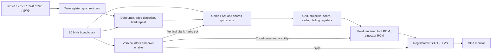
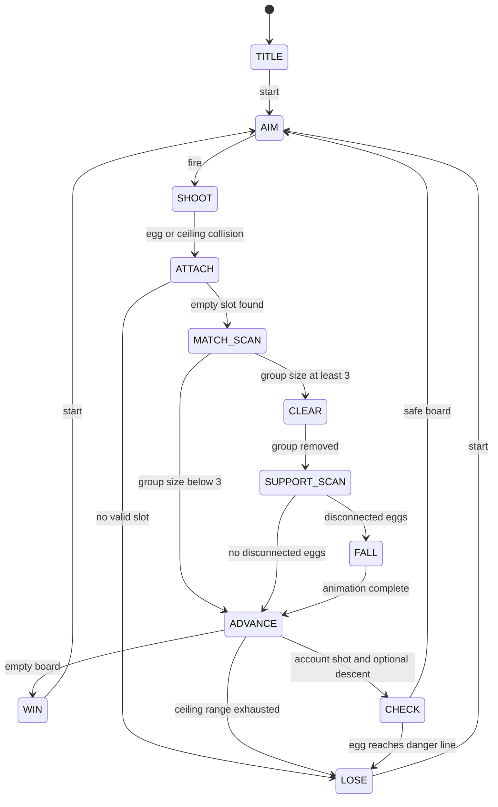
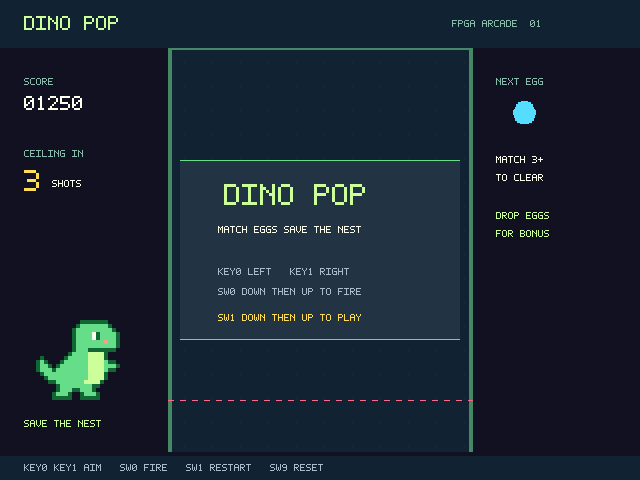
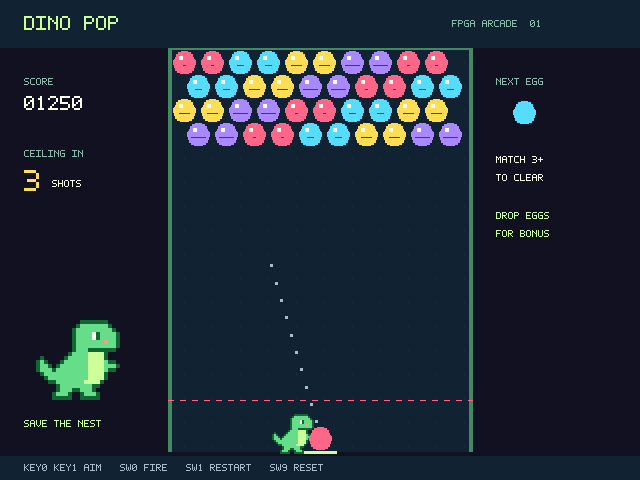
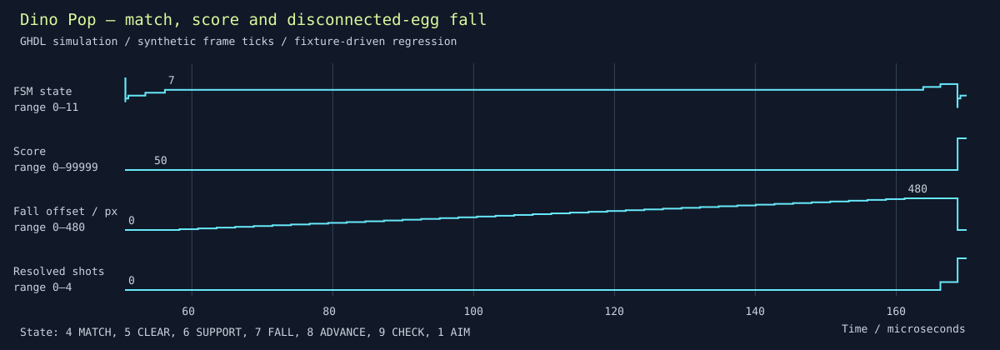

# Dino Pop — digital logic mini-project report

**Target:** DE10-Lite / MAX 10 10M50DAF484C7G. **Language:** VHDL-2008.
**Team:** two students; enter names and student IDs before submission.
**Status:** RTL implemented and simulated; Quartus fitting and real-board
verification remain pending. This report does not claim a completed hardware demo.

## 1. Name, objective and requirements

Dino Pop is an original Dynomite-style bubble shooter. The player controls a
dinosaur launcher to clear coloured eggs before a descending ceiling pushes them
to the danger line. It demonstrates sequential control, counters, registers,
graph traversal, asynchronous input conditioning and real-time VGA generation.

It addresses the course's two core requirements with a **12-state FSM** and
**640 × 480 VGA output at 59.524 Hz**. The design targets the required DE10-Lite
board and Quartus Prime Lite. Both team members must understand the complete
design and participate in the demonstration/interview.

## 2. System design

One clock domain is used throughout. A divide-by-two **enable**, not a generated
fabric clock, advances VGA counters. Gameplay movement runs once per frame.
Collision, attachment, matching and support scans run at 50 MHz between frames;
the frame tick occurs at the beginning of vertical blank to keep these updates
off the visible screen. The BFS visits at most 120 cells and six neighbours per
cell. The worst resolution sequence is only a few thousand clock cycles, within
the 72,000-cycle vertical-blank interval.

The renderer computes the cell under each pixel instead of drawing 120 eggs in
parallel. It uses two layers for attached and falling eggs, procedural egg
shapes, a 5 × 7 font, and an original 24 × 20 indexed dinosaur sprite ROM. No
commercial game art is included. Quartus resource utilization and achieved
clock frequency cannot be reported until the blocked fitter flow runs.

## 3. FSM specification

The complete machine-readable state table is [state_table.csv](state_table.csv).
Global transitions are omitted from the diagram to keep it readable: reset
always enters TITLE and clears state; start/restart always reloads the initial
level and enters AIM. All states self-hold until their documented conditions.
Aim/fire are accepted only in AIM. A fire pulse while busy is discarded.

### Grid and projectile rules

- Storage: 120 cells, each empty or colour 1–4. Four initial rows use
  `((column / 2 + row) mod 4) + 1`.
- Cell centres: `x = 184 + 28*column + 14*(row mod 2)`;
  `y = 62 + 24*row + ceiling_offset`. Odd rows shift right.
- Six neighbours: left/right and the two closest cells in each adjacent row.
  Out-of-bounds neighbours are excluded; the graph is symmetric.
- Launcher: (320, 438). Angle index 0–16 maps to −64°..+64°, 8° steps.
  Velocity is a fixed LUT rounded to 1/256 pixel, approximately six pixels/frame.
- Projectile centre reflects at x=182 and x=458, preserving overshoot. Collision
  uses centre distance <=28 pixels, matching grid spacing and providing a small
  contact tolerance around the 24-pixel decorative egg silhouettes.
- Occupied collision: attach to the nearest empty neighbour of the nearest hit
  egg. Ceiling collision: attach to the nearest empty top-row cell. Row-major
  scan order breaks equal-distance ties. No valid candidate means loss.
- Match BFS marks cells when enqueued, preventing duplicates and queue overflow.
  Groups of at least three clear. A second BFS starts from all occupied top-row
  cells; unvisited eggs disconnect and fall.
- Falling eggs are removed from occupancy before animation. Their independent
  render layer moves down 12 pixels per frame for 41 ticks, then clears.
- Matching scores 10/egg; falling scores 20/egg; score saturates at 99,999.
- A five-shot counter advances once per resolved shot. On the fifth shot the
  ceiling moves down 24 pixels. An empty board wins before this movement. An egg
  with `centre_y + 12 >= 400` loses after resolution/descent.
- A nonzero 16-bit LFSR runs continuously. Current/next eggs are restricted to
  colours present on the board. The preview is retained unless its colour was
  eliminated by the last shot.

## 4. Input/output specification

KEY0 and KEY1 are active-low and aim left/right. Each produces a press event
after 10 ms stable input and repeats every 150 ms while held. Simultaneous left
and right cancel. SW0 produces one fire pulse on a debounced rising edge. SW1
produces one start/restart pulse. SW9 is a debounced active-high reset level.
All five inputs pass through two synchronizing registers before debounce. A
power-on counter holds reset during initial input settling. SW2–SW8 are unused.

Outputs are four bits per RGB channel plus active-low VGA_HS and VGA_VS.
Physical pin references and electrical standards are in [pin_sources.md](pin_sources.md).
No external controller, ADC, RAM, audio or saved score is required.

## 5. VGA screen specification

Visible region: 640 × 480; horizontal total 800, vertical total 525. At 25 MHz:
line period 32 microseconds; frame period 16.8 ms; refresh 59.524 Hz. Horizontal
front porch/sync/back porch are 16/96/48 pixels. Vertical values are 10/2/33 lines.
RGB is black outside the visible area. Sync and colour outputs are registered
together at the pixel enable so the same pixel's timing and colour stay aligned.

The arena spans x=168..472, y=48..451. A dashed pink danger line is at y=400.
Left HUD: five-digit score and shots until descent. Right HUD: next egg and
matching instructions. Bottom: physical controls. Eggs are pink, cyan, gold,
and lavender, with highlights and distinct dark markings. A ten-dot aiming
guide follows the selected direction. Dinosaur artwork appears beside the
arena and at the launcher. Title/win/lose overlays replace the arena centre and
show the start/restart instructions; the score remains visible.

These are **simulation-generated pixel captures**, not photographs of a monitor.

## 6. Test specification and evidence

The assertions and fixtures live in `sim/`. [verification.md](verification.md)
lists results, reproduction commands, compiler limitations and hardware checks.
The game test produces VCD signals for state, score, projectile position, shot
counter, ceiling and falling offset. `state_code` uses the numeric codes in the
state table. Input tests separately expose debounce and repeat behaviour.

The waveform excerpt includes testbench fixture loading to isolate difficult
cases. Its time scale is accelerated: the engine test supplies synthetic frame
ticks; `tb_vga` separately verifies the real 16.8 ms frame. Test fixtures are
constant-eliminated from the hardware top level.

**Hardware evidence pending:** add a photograph showing the DE10-Lite and monitor,
plus close-ups of gameplay and an end screen. Record monitor model, build version,
test date and observed results. Do not substitute simulated images for these.

## 7. Development issues and resolutions

- Board-specific VGA pins differed from the generic course list. Resolved by
  checking the manufacturer manual and exposing only RGB/HS/VS.
- GHDL helper processes could not start in the sandbox. Compilation succeeded
  with the installed tool outside that restriction.
- Windows Application Control blocked a generated LLVM test executable. The
  official GHDL mcode backend completed the same tests without generating
  separate test executables; security settings were not changed.
- An initially selected collision fixture was outside the hit radius. Corrected
  its test coordinates, then added full-flight checks across all 17 angles.
- GHDL's synthesis backend rejected a dynamic absolute-value initializer. The
  shape function now uses equivalent explicit comparisons; full synthesis passes.
- Quartus's installed `ip-catalog.exe` helper is blocked by Windows Application
  Control. This remains unresolved. A working, trusted Quartus installation or
  administrator-approved repair is needed before fitting/programming.

## 8. Team responsibilities and demo

Enter actual names and contributions, not assumed completion claims:

- **Member 1 — name/ID pending:** gameplay FSM, hex-grid matching, scoring and
  gameplay test evidence; explain BFS, attachment and ceiling progression.
- **Member 2 — name/ID pending:** VGA, input conditioning, renderer, integration
  and report evidence; explain counters, sync, debounce and clock enables.
- **Both:** review all source, run tests, verify constraints and hardware, and
  answer questions about the complete system. Record any changes to this split.

Demo sequence: show reset/title; start; aim and bounce a shot; show a match and
disconnected drop; count five shots and show descent; show win/loss; restart
during play. Explain state transitions using the state table and waveform.

The hand-in is complete only after successful Quartus compilation/timing review,
real-board tests, photographs, student details and the joint demonstration.
